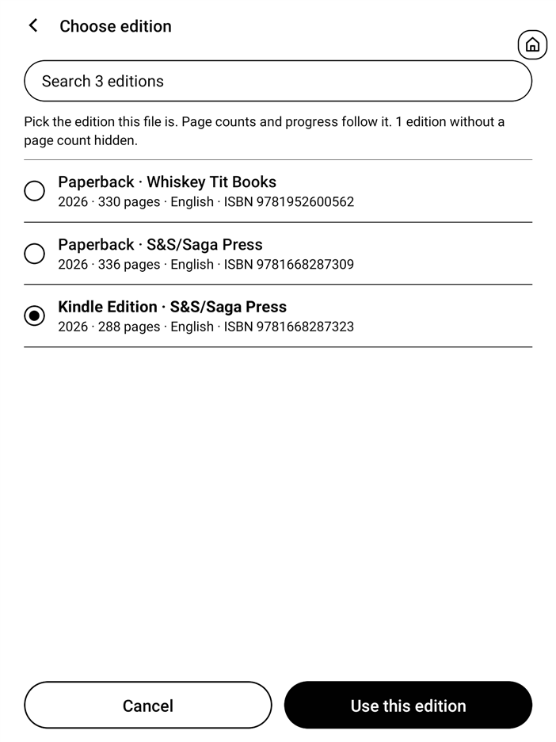
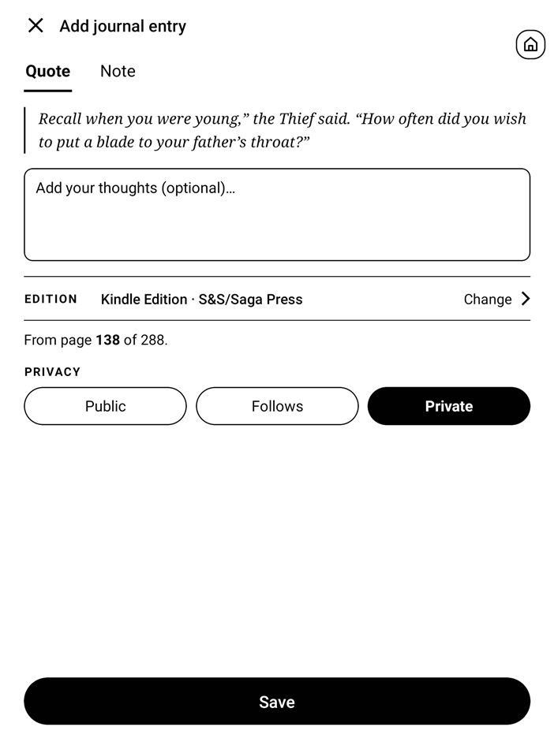
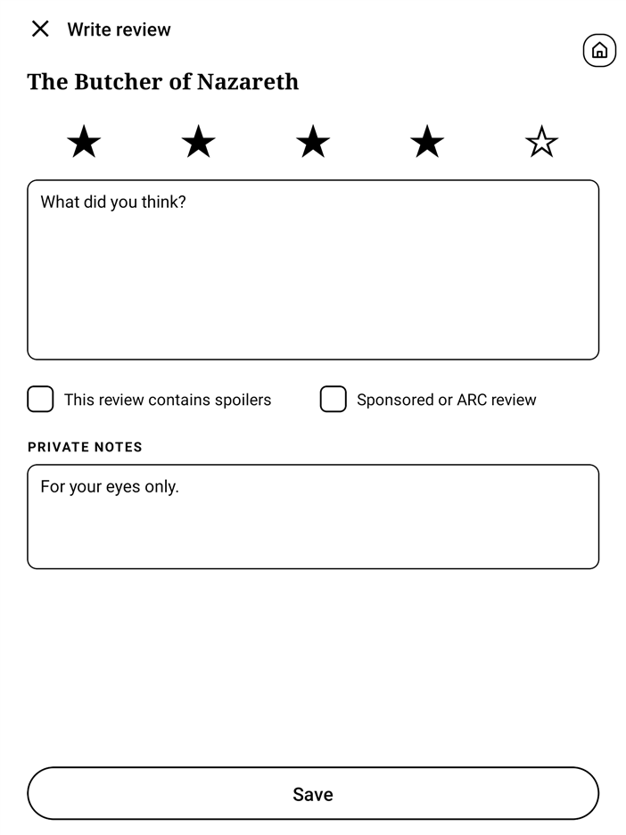

# Hardcover for Supernote

A Supernote plugin that keeps your [Hardcover](https://hardcover.app) reading progress up to date while you read EPUBs. Switch it on for a book, then just read. It also puts the book's Hardcover page on your device, and saves quotes, notes and reviews.

It runs fully on the device. The only network traffic is to Hardcover.

  
  
  
  

## Features

- **Progress tracking.** Page turns in the open EPUB are sent to Hardcover, forwards and backwards, at most once every 10 seconds per book.
- **Finds the book by itself.** Title, author and ISBN come from the EPUB's metadata, not the filename, and are matched against your Hardcover library, then the whole Hardcover catalogue.
- **Uses your edition.** Pick the edition you own and page numbers are computed against it. Font size and orientation don't matter.
- **Off by default, per book.** A Tracking switch on each book's page decides whether your progress is sent.
- **Book page.** Cover, rating, progress, genres, moods, tags and description, other readers' reviews, and your own journal for the book.
- **Quotes and notes.** Select text and save it as a quote (with your thoughts, if you like) or write a note. Both go to your Hardcover reading journal with the page you are on. You can edit and remove them from the Journal tab.
- **Status and review.** Change the reading status, rate the book and write a review.

## Requirements

- A Supernote with plugin support. Only the **Nomad** has been tested; other models may work and reports are welcome ([#38](https://github.com/richtigerkiko/supernote-hardcover/issues/38)).
- A [Hardcover](https://hardcover.app) account.
- Wi-Fi while you read, for the updates to go out.
- Books as EPUB files.

## Install

1. Download `supernote-hardcover.snplg` from the [latest release](https://github.com/richtigerkiko/supernote-hardcover/releases/latest).
2. Copy it into the `MyStyle` folder on your Supernote (for example over USB).
3. On the Supernote, open **Settings > Apps > Plugins > Select Plugin Package**, select the file and tap **Install**.
4. Open an EPUB, tap the **Plugins** icon (the puzzle piece) in the toolbar and choose **Hardcover**. Allow file and internet access if the device asks.
5. Tap **Sign in**. The page shows a link, a code and a QR code. Scan the QR code with your phone (or open the link on any device and type the code), log in to Hardcover and approve. The Supernote continues by itself.
6. On the book's page, switch **Tracking** on. That's it: keep reading.

To update, install a newer package the same way. To remove the plugin, use **Uninstall** on its page under Settings > Apps > Plugins.

## Usage

**Tracking.** Tracking is per book and starts off. Once it is on, you don't need to press anything: progress follows your page turns. Progress is only sent for a book whose status is Currently reading; set it with the status button on the book's page. Reaching the last page does not mark the book as finished: pick Finished yourself. **Plugins > Hardcover** opens the book's page with the current progress; if a sync failed, the reason is shown under the progress bar.

**Books not in your library.** If the open book is not in your Hardcover library, the plugin looks it up in the Hardcover catalogue and asks once whether to add it (as Want to Read, with your copy marked as owned). If you say no, the book page and the journal still work, and an **Add to library** button replaces tracking and status.

**Edition.** Tap **Change** next to the edition to pick the one you are reading. Progress is sent as a page of that edition. Editions without a page count are not listed.

**Quotes and notes.** Select text in the book, then tap the Hardcover icon (a book with a star) in the selection toolbar. Choose **Quote** to save the passage, optionally with your thoughts, or **Note** to write a note without the passage. Each entry has its own privacy setting (Public, Follows, Private) and is **Private** unless you change it.

**Status.** The button at the bottom left of the book page changes the reading status.

**Review.** **Write review** opens a form with a star rating (half stars by dragging), the review text, a spoiler flag and private notes.

## Troubleshooting and limits

- **EPUB only.** PDFs and other formats are not supported yet ([#16](https://github.com/richtigerkiko/supernote-hardcover/issues/16)).
- **Progress is one touch behind.** The plugin learns about a page turn at your next touch of the screen, and sends at most one update every 10 seconds. The last page you turned before putting the device down goes out when you touch it again.
- **"This book is not in your Hardcover library."** Hardcover's catalogue has no match for the title, author or ISBN in the file. Check the EPUB's metadata (for example with Calibre), or add the book on hardcover.app first.
- **"Could not read this EPUB's title and author."** The file has no usable metadata. Fix it with Calibre and copy the file again.
- **"Hardcover has no edition with a page count for this book."** Progress needs a page count. Add one to an edition on hardcover.app.
- **"Set the book to Currently reading to track it."** Tracking is on, but the book has another status on Hardcover, so nothing is sent. Change the status on the book's page.
- **"Signed out, tracking stopped"**, or a message that the sign-in has expired: open Plugins > Hardcover and sign in again, then check that Tracking is still on.
- **"This version needs a new sign-in with more access."** A newer version uses more of Hardcover's API than you approved earlier. Sign in again.
- **Nothing arrives on Hardcover.** Check Wi-Fi, that Tracking is on for this book, and the line under the progress bar on the book page.
- **"This plugin version is too low."** The device already has the same or a newer version installed.

## Privacy

- The plugin talks only to Hardcover (`hardcover.app` and its API and image servers). There is no other server, no analytics and no telemetry.
- You sign in on Hardcover's own site. The plugin never sees your password; it stores the access tokens Hardcover issues in its private folder on the device, and nowhere else.
- It reads the title, author and ISBN from the EPUB you have open. Book files and their text never leave the device, except a passage you choose to save as a quote.
- Opening the Hardcover page looks the book up (by ISBN, title and author) in your library and in Hardcover's catalogue. No reading progress is sent for a book until you switch Tracking on. Progress updates then appear on Hardcover like any other progress update, with your account's privacy setting. Quotes and notes are private unless you choose otherwise.

## Contributing

Build instructions, the code layout and the release flow are in [docs/developer.md](docs/developer.md). Bug reports and reports from other Supernote models are welcome in the [issues](https://github.com/richtigerkiko/supernote-hardcover/issues).

## License

[MIT](LICENSE)

This is an independent, community-made plugin. It is not affiliated with or endorsed by Hardcover or by Ratta (Supernote).
